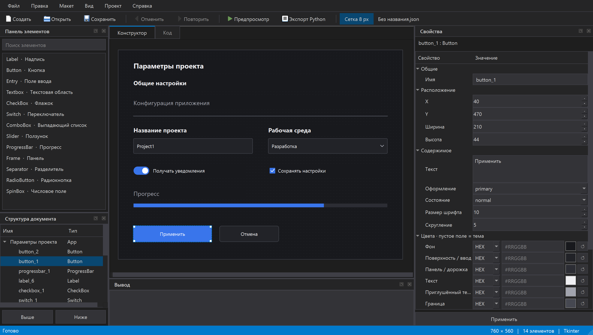
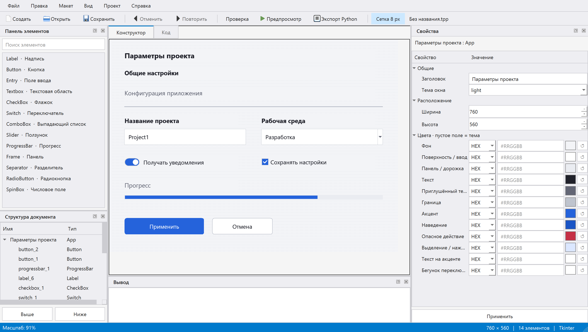

# Tkinter++

Библиотека виджетов для Python/Tkinter и визуальный редактор **на PyQt6**. Редактор использует компоновку IDE: меню, панель инструментов, закрепляемые панели элементов и свойств, структуру документа, вкладки «Конструктор» / «Код» и панель вывода. Светлая и тёмная темы. Стартовый проект содержит пустую форму без баннеров и приветственных сообщений.



<details>
<summary>Светлая тема</summary>



</details>

## Windows: готовый EXE

В [релизе v0.2.0](https://github.com/ortyanetty/TkinterPlusPlus/releases/tag/v0.2.0)
доступен **TkinterPlusPlus-0.2.0-windows-x64.exe** — один переносимый файл для
Windows x64. Скачайте его и запустите двойным щелчком. Отдельно устанавливать
Python, PyQt6 и Tkinter для редактора и предпросмотра не требуется.

Исходный код той же версии доступен в релизе как архив и в публичном репозитории.
Программа распространяется под **GNU GPLv3**; полный текст — в [LICENSE](LICENSE),
сведения о компонентах — в [THIRD_PARTY_NOTICES.md](THIRD_PARTY_NOTICES.md).
Рядом с EXE опубликован файл `SHA256SUMS.txt` с контрольными суммами.

Экспортированные файлы `.py` запускаются отдельно и по-прежнему требуют Python
с Tkinter и установленной библиотеки `tkinterplusplus`.

### Сборка EXE из исходников

```powershell
python -m venv .venv
.venv\Scripts\python -m pip install ".[editor,build]"
powershell -NoProfile -ExecutionPolicy Bypass -File scripts/build_windows.ps1
```

Результат появится в `dist/`. Сборка выполняется на Windows x64. Спецификация
PyInstaller и ресурс версии находятся в `packaging/`. Для повторения опубликованной
сборки используется Python 3.14.8, PyQt6 / Qt 6.12.0, PyQt6-sip 13.13.0,
PyInstaller 6.22.3, pyinstaller-hooks-contrib 2026.9; список зависимостей сборки
включён в исходный архив как `packaging/build-requirements.txt`.
Установить именно эти зависимости можно командой
`.venv\Scripts\python -m pip install -r packaging/build-requirements.txt`.
Проверка готового EXE: `.venv\Scripts\python tests/smoke_windows_exe.py`.
Она запускает редактор без Python в `PATH`, проверяет F5 и отдельный режим
Tkinter-предпросмотра, затем закрывает тестовые окна.

## Быстрый запуск

Нужен **Python 3.10+**, **PyQt6** и графическая среда. Для предпросмотра и экспортируемых приложений нужен Tkinter; проверить его можно командой `python -m tkinter`. В Linux может понадобиться системный пакет `python3-tk`.

```powershell
git clone https://github.com/ortyanetty/TkinterPlusPlus.git
cd TkinterPlusPlus
python -m venv .venv
.venv\Scripts\python -m pip install ".[editor]"
.venv\Scripts\python run_builder.py
```

После установки зависимостей из корня проекта также работают:

```powershell
.venv\Scripts\python -m tkinterplus
.venv\Scripts\python -m examples.demo
```

Для запуска установленного редактора:

```powershell
.venv\Scripts\tkinterplus-builder
```

На Linux/macOS вместо `.venv\Scripts\python` используется `.venv/bin/python`, вместо `.venv\Scripts\tkinterplus-builder` — `.venv/bin/tkinterplus-builder`.

Имя устанавливаемого пакета — `tkinterplusplus`, имя для импорта — **`tkinterplus`**. Дополнение `[editor]` устанавливает PyQt6. Сама библиотека Tkinter и экспортируемые приложения не требуют PyQt6: для них достаточно `python -m pip install .`. Для сборки пакета pip установит setuptools в изолированное окружение. [Официальная инструкция установки PyQt6](https://www.riverbankcomputing.com/software/pyqt/download).

Если в `.venv` этого репозитория уже установлен PyQt6, команда `python run_builder.py` автоматически использует это окружение. При запуске из другого окружения без PyQt6 выводится команда установки зависимости.

## Визуальный редактор

1. Начните с пустой формы или выберите **«Проект → Открыть пример»**, чтобы открыть форму настроек.
2. Дважды щёлкните по виджету в панели элементов либо перетащите его на рабочую область. Поле поиска фильтрует список по имени и типу.
3. Выделите элемент мышью или в списке слоёв. Перемещайте его мышью или стрелками. Изменяйте размер за квадрат в нижнем правом углу выделения.
4. Измените параметры справа и нажмите **«Применить»**. Текстовые поля поддерживают несколько строк. В выпадающем списке варианты указываются по одному в строке; текущее значение должно совпадать с одним из них.
5. Снимите выделение щелчком по свободному месту или выберите **«Проект → Параметры окна»**, чтобы изменить заголовок, размер и тему создаваемого окна. Если виджет не помещается в новый размер, сначала переместите или уменьшите его. Тема самого редактора меняется отдельно в **«Вид → Тема редактора»**.
6. **«Сохранить»** записывает редактируемый проект JSON. **«Открыть»** восстанавливает его. **«Экспорт Python»** создаёт запускаемый файл `.py`. Во вкладке **«Код»** можно посмотреть и скопировать текущий исходник.
7. **«Предпросмотр»** запускает настоящее Tkinter-приложение в отдельном процессе. Поля, списки, флажки и переключатели работают; изменения в предпросмотре не меняют проект. Закрытие редактора завершает запущенные им процессы предпросмотра.

Панели можно перемещать, отсоединять и скрывать. Меню **«Вид»** возвращает скрытые панели и восстанавливает исходную компоновку. Палитра, свойства и рабочая область прокручиваются. Кнопка «Сетка 8 px» включает точки на холсте и привязку при перемещении и изменении размеров. Порядок слоёв определяет наложение элементов: верхний пункт структуры документа отображается поверх остальных. Кнопки «Выше»/«Ниже» и контекстное меню меняют этот порядок. Сообщения сохранения, экспорта и ошибки предпросмотра отображаются в панели «Вывод».

| Клавиши | Действие |
| --- | --- |
| Ctrl+N / Ctrl+O | Новый / открыть проект |
| Ctrl+S / Ctrl+Shift+S | Сохранить / сохранить как |
| Ctrl+E | Экспорт Python |
| Ctrl+Z / Ctrl+Y | Отмена / повтор |
| Ctrl+Shift+Z | Повтор |
| Ctrl+D / Delete | Дублировать / удалить элемент |
| Стрелки | Перемещение выбранного элемента на 8 px с привязкой, иначе на 1 px |
| Escape | Снять выделение |
| F5 | Предпросмотр |

Отмена, удаление и стрелки при вводе текста работают с текстовым полем. Несохранённые изменения обозначаются звёздочкой в заголовке. Перед закрытием, открытием другого проекта или созданием нового редактор предложит сохранить изменения.

## Библиотека

```python
import tkinterplus as tpp

app = tpp.App(title="Параметры", width=520, height=320, theme="dark")
panel = tpp.Frame(app)
panel.pack(fill="both", expand=True, padx=20, pady=20)

title = tpp.Label(panel, text="Параметры", font_size=16, weight="bold")
title.pack(anchor="w", padx=20, pady=(20, 12))

name = tpp.Entry(panel, value="Project1")
name.pack(fill="x", padx=20, pady=8)

def apply():
    title.configure(text=f"Проект: {name.get()}")

button = tpp.Button(panel, text="Применить", command=apply)
button.pack(anchor="w", padx=20, pady=12)

app.mainloop()
```

| Класс | Основные параметры / методы |
| --- | --- |
| `App` | `title`, `width`, `height`, `theme`, `set_theme("light"/"dark")`, `colors` |
| `Frame` | `variant="surface"/"panel"/"background"` |
| `Label` | `text`, `font_size`, `weight="normal"/"bold"`, `muted`, `anchor="w"/"center"/"e"` |
| `Button` | `text`, `command`, `variant="primary"/"secondary"/"danger"`, `state`, `invoke()`, `configure(...)` |
| `Entry` | `value`, `get()`, `insert(...)`, `delete(...)` |
| `Textbox` | `value`, `get_value()`, стандартные методы `tk.Text` |
| `CheckBox` | `text`, `value`, `variable`, `get()`, `set(bool)` |
| `Switch` | `text`, `value`, `command` получает новое значение, `get()`, `set(bool)` |
| `ComboBox` | `options`, `value`, `get()`, `set(...)` |
| `Slider` | `value` от 0 до 100, `command`, `get()`, `set(...)` |
| `ProgressBar` | `value` от 0 до 100, `widget["value"] = 80` |
| `Separator` | Горизонтальная линия |

Виджеты используют обычные `pack`, `grid` и `place`; родительское окно — `tpp.App`. При `place(width=..., height=...)` размеры задаются в пикселях. В текстовых виджетах параметры конструктора `width`/`height` сохраняют стандартные единицы Tkinter (символы/строки). Не смешивайте `pack` и `grid` внутри одного родителя.

## Экспорт и формат проекта

Экспортированный Python-файл использует `import tkinterplus as tpp` и функцию `build_app()`. Его можно запустить из корня этого репозитория. Для запуска из другой папки установите библиотеку **в то же окружение Python**, которым будете запускать файл:

```powershell
python -m pip install "C:\путь\к\TkinterPlusPlus"
python app.py
```

Программный доступ к проектам и генератору:

```python
from pathlib import Path
from tkinterplus.project import Project, demo_project
from tkinterplus.codegen import generate_python

project = demo_project()
project.save("project.json")
restored = Project.load("project.json")
Path("app.py").write_text(generate_python(restored), encoding="utf-8")
```

Пример JSON находится в `examples/starter.json`, соответствующий Python-код — в `examples/generated_app.py`. Формат имеет версию `1`: параметры окна и упорядоченный список виджетов с типом, именем, координатами, размерами и свойствами. При открытии проверяются типы, диапазоны, уникальность имён и границы окна. Неизвестные виджеты и свойства отклоняются. Строки в экспортируемом коде записываются как Python-литералы.

## Границы версии 0.2

- Редактор использует абсолютные координаты и фиксированный размер экспортируемого окна. Масштабирование холста и адаптивная раскладка не реализованы.
- Холст PyQt отображает представление Tkinter-виджетов средствами Qt. Точное отображение шрифтов, метрик и интерактивного поведения проверяется через F5 в настоящем Tkinter-приложении.
- Все элементы в редакторе размещаются непосредственно в окне. `Frame` служит визуальной панелью; вложенность, вкладки и прокручиваемые контейнеры в редакторе пока отсутствуют. Вручную библиотечные виджеты можно вкладывать в `Frame`.
- Редактор создаёт внешний вид интерфейса. Обработчики кнопок и прикладную логику добавляют в экспортированный Python-код вручную. Повторный экспорт перезаписывает выбранный файл; проект JSON остаётся исходником визуальной части.
- До 500 элементов на проект, окно до 4096 × 4096 px, JSON до 5 МиБ, история до 100 действий.
- Проекты сохраняют только применённые свойства. Изменения в правой панели нужно подтвердить кнопкой «Применить».

## Проверка

```powershell
.venv\Scripts\python -m unittest discover -v
```

Тесты проверяют формат JSON, отклонение неверных данных, сохранение без повреждения предыдущего файла при ошибке валидации, экранирование строк, запуск экспортированного приложения, темы, события мыши и клавиатуры Qt, размеры, свойства, слои, отмену, сохранение, экспорт и запуск отдельного процесса Tkinter. GUI-тесты открывают окна: нужен доступный графический сеанс. Временные файлы проверок создаются внутри `.qa/` в каталоге проекта. Без установленного PyQt6 тесты редактора пропускаются; для полной проверки установите `[editor]`.

Проверено на Windows с Python 3.14.8, PyQt6 / Qt 6.12.0 и Tk 9.0.4. Другие системы не проверялись вручную. Проекты JSON версии 1, сохранённые редактором 0.1, открываются без конвертации.
