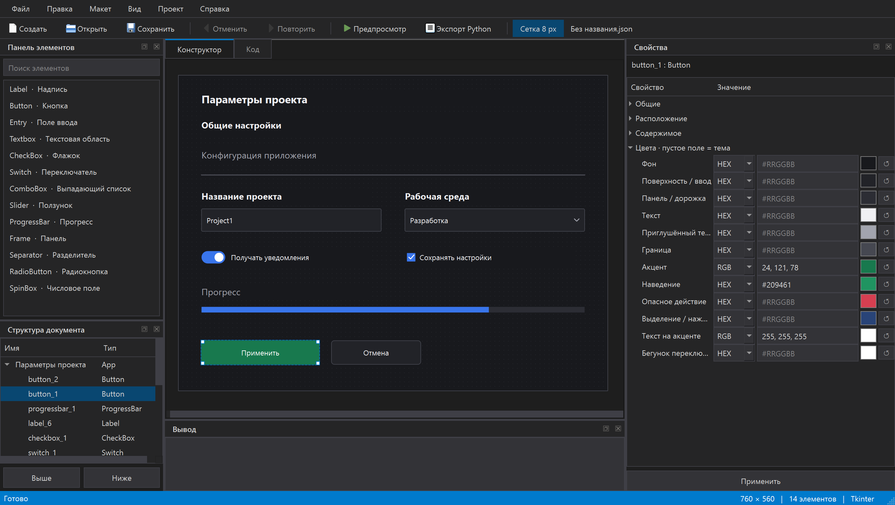

# Руководство по библиотеке Tkinter++

Библиотека `tkinterplus` создаёт окна и виджеты на Tkinter. Редактор работает на PyQt6, но **для написанного вручную приложения PyQt6 не нужен**.

## Содержание

- [Установка](#установка)
- [Как сделать кнопку](#как-сделать-кнопку)
- [Поле ввода и обработчик нажатия](#поле-ввода-и-обработчик-нажатия)
- [Цвета: HEX и RGB](#цвета-hex-и-rgb)
- [Светлая и тёмная темы](#светлая-и-тёмная-темы)
- [Размещение: pack, grid, place](#размещение-pack-grid-place)
- [Виджеты и их методы](#виджеты-и-их-методы)
- [Как использовать экспорт редактора](#как-использовать-экспорт-редактора)
- [Частые ошибки](#частые-ошибки)

## Установка

Нужен Python 3.10+ с Tkinter. В Windows Tkinter входит в обычную установку Python; в Linux может потребоваться пакет `python3-tk`.

Скачайте исходники с GitHub, откройте терминал в папке проекта и выполните:

```powershell
python -m venv .venv
.venv\Scripts\python -m pip install .
.venv\Scripts\python -m examples.button
```

Для установки редактора используйте `pip install ".[editor]"`. Имя пакета при установке — `tkinterplusplus`, а имя в Python — `tkinterplus`.

## Как сделать кнопку

Полностью работающая программа. Сохраните как `my_app.py` и запустите Python из окружения, в котором установлена библиотека.

```python
import tkinterplus as ui

root = ui.Tk()
root.title("Моя программа")
root.geometry("420x240")

status = ui.Label(root, text="Ожидание нажатия")
status.pack(pady=30)

def on_click():
    status.configure(text="Кнопка нажата")

button = ui.Button(root, text="Нажать", bg="#2563eb", fg="white", command=on_click)
button.pack()
root.mainloop()
```

`root = ui.Tk()` создаёт окно. `title()` задаёт заголовок, `geometry("420x240")` — размер. `ui.Button(root, ...)` создаёт кнопку в окне `root`, а `pack()` размещает её. `root.mainloop()` в конце запускает обработку нажатий.

`text` — надпись, `bg` — фон кнопки, `fg` — цвет текста. Можно передать HEX `"#2563eb"`, RGB `(37, 99, 235)` или имя цвета Tkinter, например `"white"`. После создания цвет меняется так: `button.configure(bg=(20, 100, 180))` или `button["bg"] = "#1464b4"`.

В следующих примерах `app` означает созданное окно; его можно назвать и `root`. Старое имя `ui.App(...)` продолжает работать. Готовая простая программа: [examples/simple_button.py](../examples/simple_button.py).

`command=on_click` передаёт функцию, которая вызывается при нажатии. Скобки в `command=on_click()` вызовут её сразу при создании кнопки.

Варианты оформления:

```python
primary = ui.Button(app, text="Сохранить", variant="primary")
secondary = ui.Button(app, text="Отмена", variant="secondary")
danger = ui.Button(app, text="Удалить", variant="danger")

primary.configure(text="Готово", state="disabled")
primary.configure(state="normal", font_size=11, radius=6)
# Вызвать обработчик программно:
primary.invoke()
```

После создания разместите элементы с помощью `pack()`, `grid()` или `place()`.

Готовый файл: [examples/button.py](../examples/button.py).

## Поле ввода и обработчик нажатия

```python
import tkinterplus as ui

app = ui.App(title="Форма", width=480, height=300, theme="light")
app.columnconfigure(0, weight=1)

ui.Label(app, text="Ваше имя", weight="bold").grid(
    row=0, column=0, sticky="w", padx=24, pady=(24, 8))
name = ui.Entry(app, value="")
name.grid(row=1, column=0, sticky="ew", padx=24)
result = ui.Label(app, text="")
result.grid(row=3, column=0, sticky="w", padx=24, pady=16)

def save():
    value = name.get().strip()
    result.configure(text=f"Сохранено: {value}" if value else "Введите имя")

ui.Button(app, text="Сохранить", command=save).grid(
    row=2, column=0, sticky="w", padx=24, pady=(20, 0))
app.mainloop()
```

Обычные методы Tkinter доступны: `entry.get()`, `entry.delete(0, "end")`, `entry.insert(0, "Новое значение")`, `entry.bind("<Return>", callback)`.

Для пароля: `ui.Entry(app, show="•")`. Для блокировки: `entry.configure(state="disabled")`; для восстановления — `state="normal"`. `readonly` оставляет текст доступным для чтения и копирования.

## Цвета: HEX и RGB

Каждый виджет и само окно принимают `colors={...}`. Значение цвета можно передать как **HEX** `"#2563eb"` или как **RGB** `(37, 99, 235)`. Допустим также список `[37, 99, 235]`. RGB-каналы — целые числа от 0 до 255. Альфа-канал не используется.

### Цвета всего приложения

```python
app = ui.App(
    title="Свои цвета", theme="dark",
    colors={
        "background": "#16181d",  # HEX
        "surface": (32, 35, 43),   # RGB
        "accent": (124, 92, 224),
        "hover": "#9072ee",
        "text": "#f1f3f8",
        "on_accent": "#ffffff",
    },
)
```

### Цвета отдельного элемента

```python
button = ui.Button(
    app, text="Сохранить",
    colors={"accent": "#17764b", "hover": (29, 143, 91), "on_accent": "#ffffff"},
)
button.pack(padx=24, pady=24)

entry = ui.Entry(app, colors={"surface": "#fff7de", "text": (40, 35, 20), "border": "#b9a46b"})
entry.pack(padx=24, fill="x")
```

### Изменение цветов во время работы

```python
button.set_colors(accent=(200, 90, 30), hover="#dc7535")
button.set_colors()  # Удалить собственные цвета и снова наследовать тему.
app.set_colors(accent="#3975eb", background="#18191d")
```

`set_colors()` **заменяет** набор собственных цветов. Неуказанные роли наследуются. Цвета контейнера `Frame` наследуют его дочерние элементы; у ребёнка можно переопределить отдельные роли.

### Роли палитры

| Роль | Где используется |
| --- | --- |
| `background` | Фон окна; собственный фон Frame, Label, CheckBox, RadioButton и Switch |
| `surface` | Поля ввода, текстовые области, списки, вторичная кнопка |
| `panel` | Панели, дорожки ползунков и прогресса, заблокированные кнопки |
| `text` | Основной текст; собственный `text` кнопки также меняет её подпись |
| `muted` | Приглушённые надписи и заблокированные элементы |
| `border` | Рамки, разделители, выключенные индикаторы |
| `accent` | Основные кнопки, активные индикаторы, прогресс, фокус |
| `hover` | Наведение на основную кнопку и активные поля |
| `danger` | Кнопка с `variant="danger"` |
| `selection` | Выделение текста и нажатая кнопка |
| `on_accent` | Подпись на основной/опасной кнопке, галочка флажка |
| `thumb` | Кружок переключателя Switch |

Конкретный виджет использует подходящие ему роли: например, у Label нет дорожки прогресса. `colors` задаёт именно палитру, стандартные параметры Tkinter по-прежнему доступны через `configure`.

### Цвета в редакторе

Выберите окно или элемент → **«Свойства → Цвета»**. В каждой строке есть **HEX/RGB**, поле ввода, образец для открытия палитры и **↺** для сброса к теме. В RGB введите `37, 99, 235`, в HEX — `#2563eb`. Переключение формата сохраняет цвет. Нажмите **«Применить»**.

Цвета окна и виджетов сохраняются в JSON и переносятся в Python-код и настоящий предпросмотр F5. В JSON цвета записываются в едином HEX-формате. Старые JSON-проекты версии 0.2 открываются с палитрой выбранной темы.



Цвета интерфейса самого редактора настраиваются отдельно: **«Вид → Цвета редактора»**. Они действуют до закрытия редактора и не изменяют создаваемое приложение.

## Светлая и тёмная темы

```python
app.set_theme("dark")
app.set_theme("light")
print(app.theme)
print(app.colors.accent)
```

Тема обновляет уже созданные элементы. Собственные цвета сохраняются при переключении; вызовите `set_colors()` у соответствующего элемента или окна, чтобы вернуть цвета темы.

## Размещение: pack, grid, place

Все виджеты совместимы со стандартными менеджерами геометрии Tkinter.

```python
# Вертикальная компоновка.
button.pack(padx=24, pady=12, fill="x")
```

```python
# Таблица с растягивающимся столбцом.
app.columnconfigure(0, weight=1)
entry.grid(row=0, column=0, sticky="ew", padx=24, pady=12)
```

```python
# Точные координаты в пикселях, как в редакторе.
button.place(x=24, y=32, width=180, height=40)
```

Не используйте одновременно `pack` и `grid` для детей **одного** контейнера. В разных `Frame` можно использовать разные менеджеры. Размеры `Button` и `Switch` задаются в пикселях; у стандартных текстовых Tk/ttk-виджетов `width` при `pack/grid` обычно измеряется в символах. `place(width=..., height=...)` всегда задаёт пиксели.

Контейнер и вложенные элементы:

```python
panel = ui.Frame(app, variant="surface", colors={"surface": "#eaf2ff", "text": "#20304a"})
panel.pack(fill="x", padx=24, pady=24)
ui.Label(panel, text="Настройки", weight="bold").pack(anchor="w", padx=16, pady=12)
ui.CheckBox(panel, text="Сохранять настройки", value=True).pack(anchor="w", padx=16, pady=(0, 12))
```

## Виджеты и их методы

В приведённых ниже фрагментах `app` — уже созданный `ui.App`. После создания разместите элементы и вызовите один `app.mainloop()`.

### Надпись и текстовая область

```python
label = ui.Label(app, text="Заголовок", font_size=18, weight="bold", anchor="w")
hint = ui.Label(app, text="Описание", muted=True)
notes = ui.Textbox(app, value="Первая строка\nВторая строка")
print(notes.get_value())
notes.insert("end", "\nТретья строка")
```

### Флажок и переключатель

```python
check = ui.CheckBox(app, text="Запомнить выбор", value=True)
check.set(False)
print(check.get())  # bool
check.configure(command=lambda: print(check.get()))

switch = ui.Switch(app, text="Уведомления", value=False, command=lambda enabled: print(enabled))
switch.set(True)  # Программная установка; command вызывается при действии пользователя.
switch.configure(state="disabled")
```

`CheckBox.command` вызывается без аргументов, `Switch.command` получает новое булево значение.

### Выпадающий список

```python
combo = ui.ComboBox(app, options=["Русский", "English"], value="Русский")
print(combo.get())
combo.set("English")
combo.bind("<<ComboboxSelected>>", lambda event: print(combo.get()))
```

### Радиокнопки

```python
first = ui.RadioButton(app, text="Светлая", group="theme", value="light", selected=True)
second = ui.RadioButton(app, text="Тёмная", group="theme", value="dark")
first.pack(anchor="w")
second.pack(anchor="w")
print(first.get())  # Выбранное значение общей группы.
```

Одинаковый `group` внутри одного контейнера объединяет варианты. Вместо `group` можно передать общую `tkinter.StringVar` через `variable`.

### Числовое поле

```python
number = ui.SpinBox(app, value=8, from_=1, to=64, increment=1)
number.pack()
print(number.get())  # Текст; при необходимости преобразуйте в int/float.
number.set(16)
```

### Ползунок и прогресс

```python
progress = ui.ProgressBar(app, value=35)
progress.pack(fill="x", padx=24, pady=12)
slider = ui.Slider(app, value=35, command=lambda value: progress.configure(value=float(value)))
slider.pack(fill="x", padx=24)
print(slider.get())
slider.set(70)
progress.configure(value=70)
```

Ползунок по умолчанию имеет диапазон 0–100. Можно передать `from_` и `to`. Прогресс поддерживает `maximum`, `mode="indeterminate"`, `start()` и `stop()` из ttk.

### Разделитель

```python
ui.Separator(app, colors={"border": "#9ca6b8"}).pack(fill="x", padx=24, pady=16)
```

Галерея всех виджетов: `python -m examples.gallery`. Полная форма: `python -m examples.form`.

## Как использовать экспорт редактора

Экспортируйте проект в `generated_app.py`. Получится обычный Python с окном `root` и переменными `button_1`, `entry_1` и другими именами из редактора:

```python
import tkinterplus as ui

root = ui.Tk()
root.title("Форма")
root.geometry("420x240")

entry_1 = ui.Entry(root)
entry_1.place(x=24, y=24, width=260, height=38)
button_1 = ui.Button(root, text="Показать имя")
button_1.place(x=24, y=80, width=180, height=38)

# Добавьте обработчик после создания виджетов, перед mainloop:
button_1.configure(command=lambda: print(entry_1.get()))

if __name__ == "__main__":
    root.mainloop()
```

Редактор экспортирует внешний вид; обработчики и логику вы добавляете в Python. Повторный экспорт перезаписывает файл, поэтому сохраняйте свои изменения отдельно.

Для существующих программ с фабрикой доступен `generate_python(project, style="function")`. Он создаёт `build_app()` и словарь `root.widgets`, как в предыдущем экспорте. Старые имена классов также сохранены: `App`, `Textbox`, `CheckBox`, `RadioButton`, `ComboBox`, `SpinBox`, `Slider`, `ProgressBar`. Привычные имена `Tk`, `Text`, `Checkbutton`, `Radiobutton`, `Combobox`, `Spinbox`, `Scale`, `Progressbar` обозначают те же классы.

**Настоящий холст:** «Конструктор» позволяет выделять, перемещать и менять размеры. Нажмите **«Проверка» / F6**, чтобы вводить текст, переключать флажки, открывать списки и двигать ползунки. Повторное F6 возвращает конструктор и значения проекта. F5 открывает отдельное окно. Проверка не изменяет сохранённые свойства.

В редакторе: Ctrl+щелчок, рамка мышью или Ctrl+A выделяют несколько элементов; Ctrl+C/X/V копируют, вырезают и вставляют группу. Меню «Макет» выравнивает элементы, задаёт одинаковые размеры по активному элементу и распределяет промежутки (нужно минимум три элемента). Свойства справа относятся к указанному активному элементу, групповое перемещение и команды «Макет» — ко всему выделению. Ctrl+колесо меняет масштаб.

Редактор размещает элементы в координатах окна через `place`; вложенные контейнеры и адаптивные `grid/pack` создавайте в коде библиотеки. Вкладка «Код» показывает генерируемый Python.

## Частые ошибки

- **`No module named tkinterplus`**: установите исходники в то же окружение Python, которым запускаете файл.
- **Окно сразу закрывается**: в конце программы нужен `app.mainloop()`.
- **Кнопка вызывает функцию сразу**: передавайте `command=save`, без скобок.
- **Элемент не виден**: после создания вызовите `pack`, `grid` или `place`.
- **Неверный цвет**: HEX содержит `#` и шесть цифр; RGB — три целых числа от 0 до 255.
- **Интерфейс зависает во время долгой операции**: не запускайте долгую работу в обработчике GUI; используйте `after()` для небольших шагов или фоновый поток, обновляя Tk только из главного потока.
